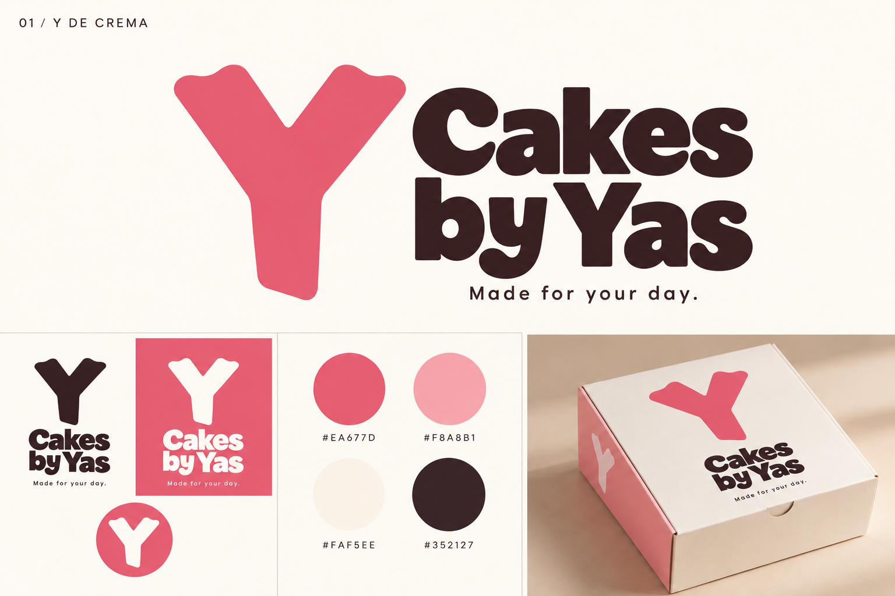
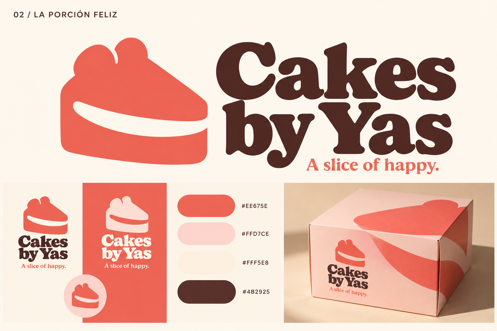
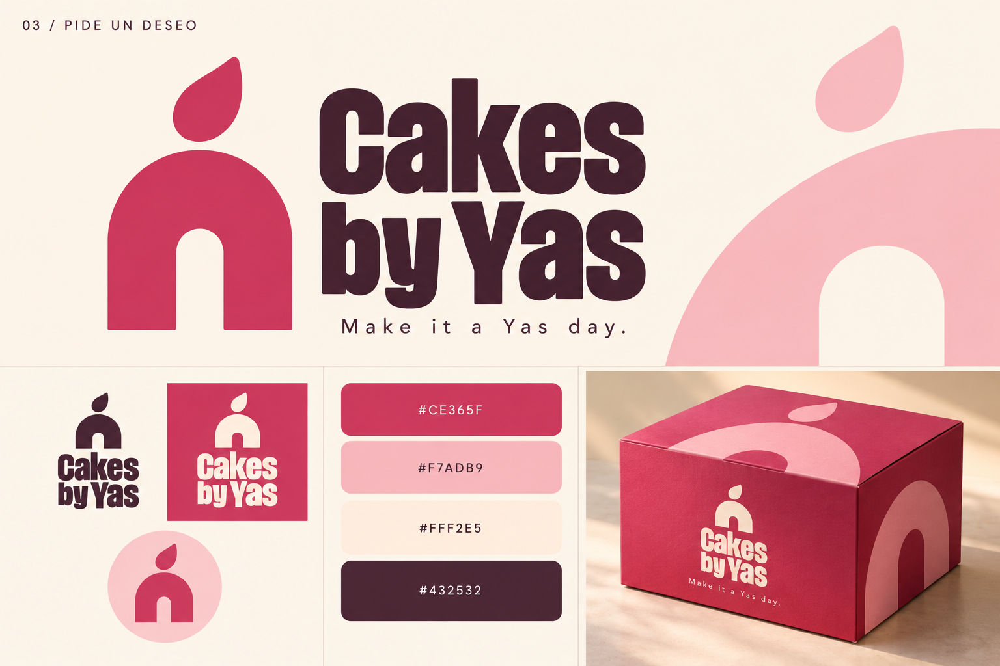
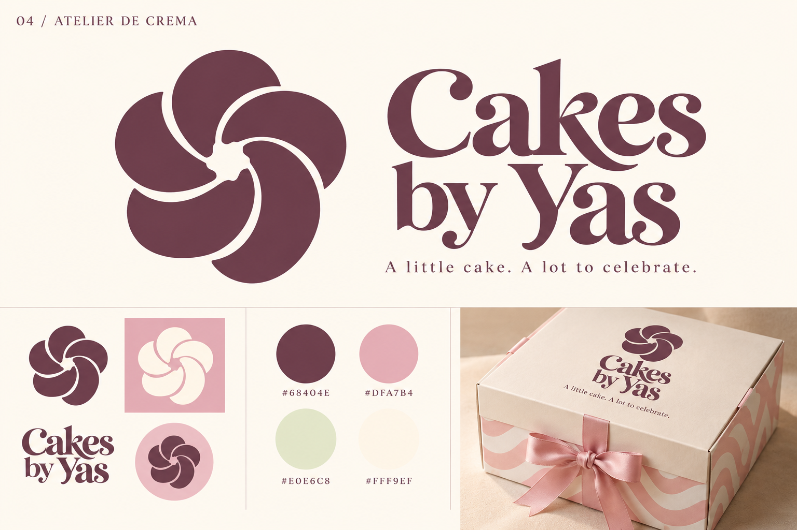
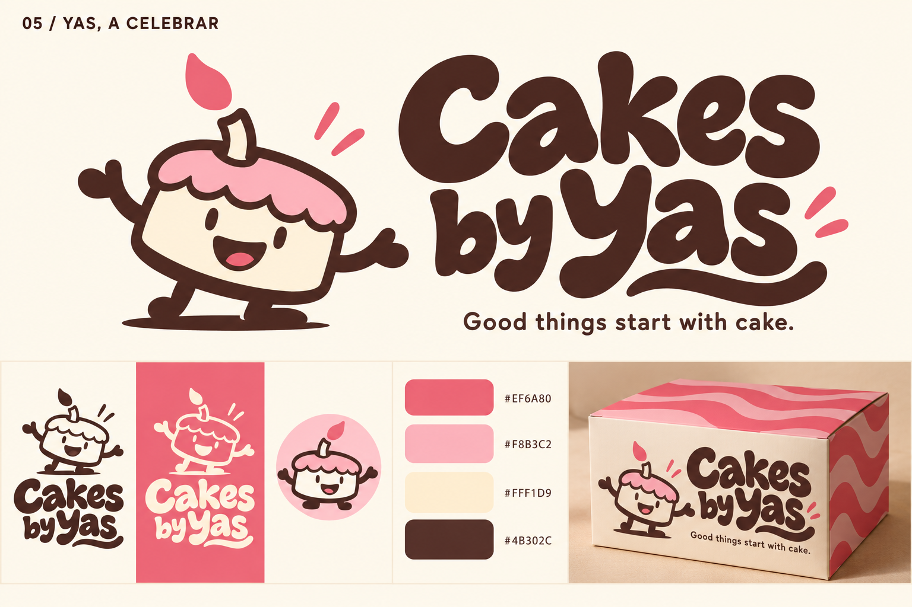

# Cakes by Yas — cinco direcciones de identidad

Fecha: 30 de octubre de 2026. Estado: exploración comparativa histórica. El usuario eligió después la Y de crema original curva con «Make it a Yas day.»; ver [dirección elegida](SELECCION.md). Las recomendaciones siguientes documentan la comparación previa a esa elección.

La petición actual abre un rediseño total y prevalece, para esta exploración, sobre la preferencia histórica de conservar el logo registrada en PRODUCT.md. Las cinco rutas mantienen el nombre Cakes by Yas. Los nombres de los conceptos son etiquetas de trabajo, no nombres nuevos del negocio. No se ha sustituido la identidad en la web.

## De dónde partimos

Fuentes consultadas: logo adjunto por el usuario (download.png); PRODUCT.md; DESIGN.md; src/data/catalog.ts; src/data/copy.ts; src/shared/tokens/primitives.css; página local /en/ observada en navegador.

El negocio se centra en pasteles personalizados de cumpleaños; las grandes celebraciones y mesas de postres amplían la oferta. Atiende a público en inglés y español en el entorno de Spring, The Woodlands y Houston. El contacto personal con Yas es parte del valor de la marca. No se supone que el negocio sea una tienda física ni una pastelería francesa.

Lectura del DOM de la web actual: coral #EA677D, rosa #F8A8B1, marfil #FAF5EE, tinta RGB 53 33 39 (#352127), titulares Apfel Grotezk, peso 800. Son datos de la web, no colores estimados del logo. El diseño usa grandes titulares, arcos, movimiento y fotografía protagonista.

Diagnóstico profesional: el logo actual comunica repostería y cercanía. El degradado y la caligrafía fina complican su reproducción pequeña. El sistema nuevo debe tener una silueta reconocible, lettering legible y un símbolo autónomo que funcione en avatar, etiqueta y caja.

## La idea común

Posicionamiento propuesto: el pastel que hace que tu celebración se sienta tuya.

Tres rasgos: alegría, cuidado artesanal y personalidad. La marca puede sentirse cuidada y deseable sin parecer inaccesible. El cumpleaños manda; la identidad debe acompañar también un flan o una mesa de postres.

La memoria se construye repitiendo pocos elementos consistentes: un símbolo, una forma tipográfica y una combinación cromática dominante. Evitar sumar utensilios, coronas, estrellas o adornos sin función.

## 01 — Y de crema

Una Y gruesa de terminales suaves, inspirada en el acabado de una manga pastelera. La inicial de Yas se convierte en firma. Lettering de gran peso, curvas amables y mucha presencia.

- Sensación: contemporánea, segura, cercana.
- Isotipo: Y compacta, independiente del nombre.
- Paleta propuesta: coral #EA677D como color protagonista y candidato de acción; rosa #F8A8B1 de apoyo; marfil #FAF5EE de fondo; cacao #352127 para texto.
- Sistema: repeticiones grandes de la Y, curvas de crema y bloques coral. En la web encaja con los titulares contundentes y los botones redondos.
- Voz: «Made for your day.» / «Hecho para tu día».
- Ventaja: la transición más natural desde la web actual, con excelente simplicidad.
- Punto a resolver: una Y aislada puede resultar genérica; su dibujo y proporciones necesitan más personalidad en la fase vectorial.

Se refinó el primer dibujo para que se leyera como letra y no como una silueta animal.

## 02 — La porción feliz

Una porción compacta con una franja curva de relleno que sugiere una sonrisa. El propio producto expresa alegría, sin necesitar ojos ni una mascota.

- Sensación: apetecible, optimista, cálida; una dirección retro contemporánea.
- Isotipo: porción de pastel con sonrisa en negativo.
- Paleta propuesta: coral cálido #EE675E protagonista y candidato de acción; melocotón #FFD7CE de apoyo; crema #FFF5E8 de fondo; cacao #4B2925 para texto.
- Lettering: serif robusta de curvas suaves y remates expresivos.
- Sistema: diagonales de porción y franjas curvas de relleno; caja con símbolo sobredimensionado.
- Web: conserva la escala y el movimiento; lleva los títulos de marca hacia una expresión más cálida. El texto funcional mantiene una sans legible.
- Voz: «A slice of happy.» / «Una porción de alegría».
- Ventaja: asociación inmediata con el producto y buen equilibrio entre emoción, claridad y reproducción.
- Punto a resolver: ajustar el contorno superior y la franja para reforzar una silueta propia frente a otras marcas de repostería.

Mi recomendación principal para desarrollar.

## 03 — Pide un deseo

Un arco grueso y una llama desplazada resumen el momento del cumpleaños. La marca se apropia del ritual de pedir un deseo. El arco conversa con las máscaras fotográficas de la web.

- Sensación: celebratoria, gráfica, editorial.
- Isotipo: arco de pastel/vela y llama.
- Paleta propuesta: frambuesa #CE365F protagonista y candidato de acción; rosa #F7ADB9 de apoyo; crema #FFF2E5 de fondo; ciruela #432532 para texto.
- Lettering: sans condensada de gran peso.
- Sistema: arcos recortados, llamas aisladas y grandes superficies de color.
- Web: aprovecha los arcos existentes y permite animar el gesto de la llama de forma contenida.
- Voz: «Make it a Yas day.» / «Haz de tu día un día Yas».
- Ventaja: ofrece un territorio emocional claro y un sistema gráfico sencillo.
- Punto a resolver: el símbolo puede leerse como una puerta o una marca de velas; habría que fortalecer su lectura de cumpleaños.

## 04 — Atelier de crema

Una roseta de cinco pliegues amplios recuerda el trabajo de la crema. La tipografía serif aporta carácter editorial y un ritmo más sereno.

- Sensación: artesanal, delicada, cuidada.
- Isotipo: roseta asimétrica de crema.
- Paleta propuesta: ciruela #68404E como tinta protagonista y candidata de acción; rosa empolvado #DFA7B4 de apoyo; pistacho #E0E6C8 como acento decorativo; marfil #FFF9EF de fondo.
- Sistema: pliegues amplios, ondas, papel crema y detalles rosa.
- Web: requiere una evolución mayor hacia títulos serif, composición más tranquila y menos competencia entre elementos.
- Voz: «A little cake. A lot to celebrate.» / «Un poquito de pastel. Mucho que celebrar».
- Ventaja: subraya el oficio y el detalle de los diseños personalizados.
- Punto a resolver: la roseta puede acercarse a cosmética o floristería; debe conservar gestos claros de manga pastelera. Los contrastes finos de la tipografía requieren versión pequeña.

## 05 — Yas, a celebrar

Un pequeño pastel con vela y gesto alegre convierte a la marca en personaje. La identidad puede saludar, celebrar y acompañar el pedido.

- Sensación: cercana, expresiva, divertida.
- Isotipo: mascota pastel autónoma.
- Paleta propuesta: coral #EF6A80 protagonista y candidato de acción; rosa #F8B3C2 de apoyo; crema #FFF1D9 de fondo; cacao #4B302C para contornos y texto.
- Lettering: letras gruesas dibujadas con ritmo y remate curvo.
- Sistema: ondas anchas, poses del personaje, etiquetas y stickers.
- Web: funciona como acento en el proceso de pedido, mensajes de contacto y cierre. La fotografía de los pasteles conserva el protagonismo.
- Voz: «Good things start with cake.» / «Lo bueno empieza con un pastel».
- Ventaja: mayor capacidad narrativa para redes, stickers y empaques.
- Punto a resolver: evitar una percepción exclusivamente infantil; preparar un símbolo simplificado para favicon y tamaños mínimos.

## Comparación y recomendación

Valoración de diseño, no resultados de un estudio de consumidores.

| Dirección | Principal fortaleza | Relación con la web | Trabajo pendiente más importante |
|---|---|---|---|
| Y de crema | Firma simple ligada a Yas | Muy directa | Hacer la Y más propia |
| La porción feliz | Producto + emoción | Muy buena | Refinar silueta distintiva |
| Pide un deseo | Ritual del cumpleaños | Directa por los arcos | Aclarar lectura del símbolo |
| Atelier de crema | Oficio y percepción cuidada | Exige más evolución | Evitar apariencia floral/cosmética |
| Yas, a celebrar | Personaje y narrativa | Compatible como acento | Equilibrar diversión y público adulto |

Desarrollaría La porción feliz como primera opción por su balance entre claridad, calidez y presencia. Elegiría Yas, a celebrar si el objetivo prioritario fuera construir una marca muy expresiva en redes. Y de crema es la alternativa más próxima al lenguaje actual de la web.

No mezclaría los cinco isotipos. Una marca memorable necesita un signo principal estable. Se pueden ajustar paleta o tono dentro de la ruta elegida, pero conviene conservar una sola idea central.

## Alcance de esta entrega

Cinco láminas conceptuales PNG de 1536 × 1024 con isotipo, lettering, paleta y aplicación en caja. Generadas con la herramienta integrada image_gen a partir de la dirección descrita. Los prompts exactos y el ajuste de la ruta 01 están en prompts.json. Las cajas son simulaciones visuales, no diseños de producción.

Las paletas y eslóganes nuevos son propuestas. El lettering generado expresa una dirección y no identifica una fuente instalada. No se ha realizado comprobación de coincidencias con otras marcas ni pruebas de recuerdo con público; no se afirma exclusividad.

Después de elegir una ruta: dibujar el maestro vectorial, fijar tipografía y espaciados, preparar versiones horizontal/vertical, positivo/negativo y reducida, comprobar tamaños y reproducción a una tinta, y definir las aplicaciones de la identidad. Para trasladarla a la web se confirmarán los roles de color y se verificarán contraste y estados antes de cambiar tokens.

