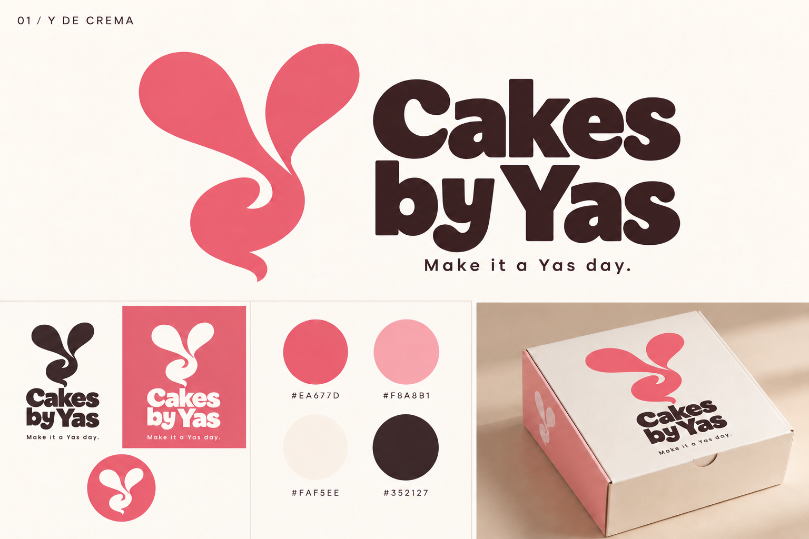

# Dirección elegida — Y de crema

El usuario ha elegido la versión original curva del isotipo (archivo de referencia exec-f818d40e-c689-4966-b8f8-0f72689082e6.png), con el eslogan **Make it a Yas day.**. Esta elección prevalece sobre la recomendación comparativa anterior. La variante de Y recta del archivo 01-y-de-crema.png no es la seleccionada.

Se conservan isotipo orgánico, lettering, paleta y composición. El nuevo eslogan aparece en la firma principal, versiones pequeñas y aplicación en caja.

Edición realizada con la herramienta integrada ImageGen. Prompt exacto: seleccion-prompt.txt. Después se preparó la [reconstrucción SVG del logo elegido](../logo-svg/README.md), con los límites de fidelidad documentados. La identidad todavía no se ha aplicado a la web.

